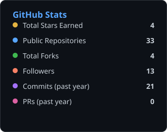
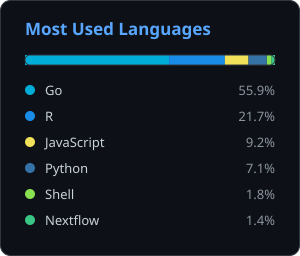

Engineer with 5 years of experience building software, data platforms, and automated workflows for scientific and operational data. Skilled in designing clean, domain-driven architectures using Python, JavaScript, and SQL, with strong experience across FastAPI, React, Docker, Terraform, AWS infrastructure.

 

### Tech Stack

**Languages**

  
  
  
  
  

**Generative AI / LLM**

  
  
  
  
  

**Cloud & Data**

  
  
  
  
  
  
  

**Frameworks**

  
  
  
  
  
  

**DevOps & Platform**

  
  
  
  
  
  
  

**Observability & ML**

  
  
  
  
  

 

### GitHub Stats

<table>
  <tr>
    <td></td>
    <td></td>
  </tr>
</table>

Generated daily by a <a href="./.github/workflows/generate-stats.yml">GitHub Action</a> from live public data — see <a href="./scripts/generate_stats.py">scripts/generate_stats.py</a>.

 

### Connect

  

